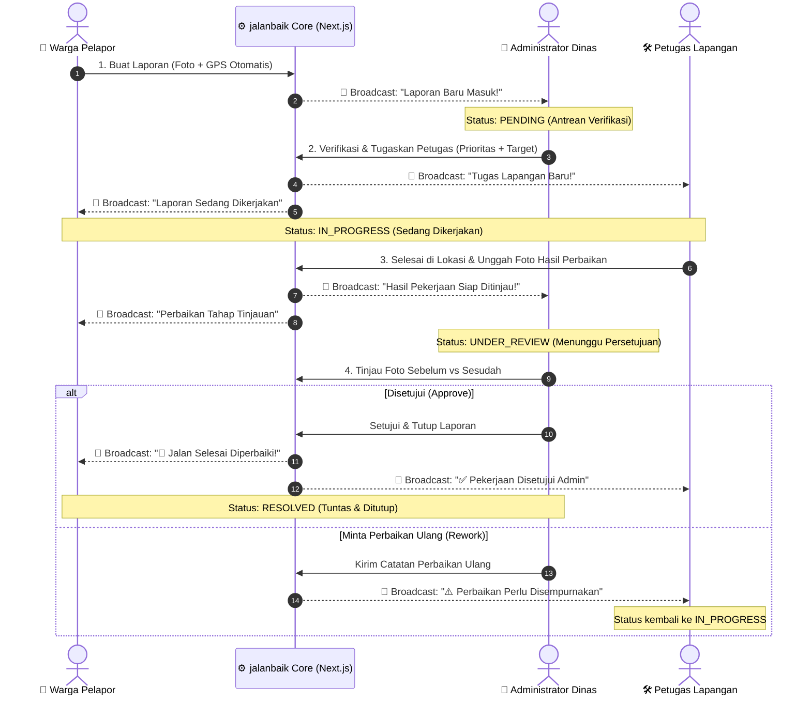

# 🛣️ jalanbaik • Platform Pengaduan & Transparansi Penanganan Jalan Rusak

> **"Jalan Lebih Baik, Bersama."**  
> Platform web pengaduan masyarakat dan transparansi operasional penanganan infrastruktur jalan terintegrasi skala *production-ready*. Menghubungkan secara instan dan transparan tiga pemangku kepentingan: **Masyarakat (Warga)**, **Petugas Lapangan**, dan **Administrator Dinas Bina Marga**.

---

## 📑 Daftar Isi
1. [Fitur Unggulan](#-fitur-unggulan)
2. [Alur Bisnis & Siklus 5 Tahap (Lifecycle Workflow)](#-alur-bisnis--siklus-5-tahap-lifecycle-workflow)
3. [Arsitektur & Tech Stack](#-arsitektur--tech-stack)
4. [Struktur Folder (Clean Architecture)](#-struktur-folder-clean-architecture)
5. [Skema Basis Data (Supabase PostgreSQL)](#-skema-basis-data-supabase-postgresql)
6. [Panduan Instalasi & Menjalankan di Lokal](#-panduan-instalasi--menjalankan-di-lokal)
7. [Panduan Lengkap Deployment ke Vercel](#-panduan-lengkap-deployment-ke-vercel)
8. [Akun Pengujian Default (Demo Credentials)](#-akun-pengujian-default-demo-credentials)
9. [Optimasi Performa & Catatan Teknis](#-optimasi-performa--catatan-teknis)

---

## 🌟 Fitur Unggulan

### 1. 👥 Manajemen Peran Terpadu (Role-Based Access Control / RBAC)
- **Warga (Citizen)**: Membuat laporan kerusakan jalan, memantau linimasa investigasi, melihat foto bukti sebelum & sesudah perbaikan, dan menerima notifikasi penyelesaian.
- **Petugas Lapangan (Officer)**: Menerima penugasan kerja lengkap dengan koordinat titik jalan, rute navigasi Google Maps satu klik, tombol kamera langsung, dan formulir penyerahan hasil.
- **Administrator Dinas (Admin)**: Memverifikasi laporan baru yang masuk, menetapkan prioritas & target tanggal selesai, menugaskan petugas, meninjau komparasi foto bukti hasil, menyetujui atau meminta perbaikan ulang, serta mengekspor data ke CSV/Excel.

### 2. ⚡ Real-Time Push Notification Multi-Peran & Audio Chime
- **Supabase Realtime Broadcast (`jalanbaik-live-room`)**: Pembaruan status terkirim seketika antar-perangkat dalam hitungan milidetik (< 200ms) tanpa perlu *refresh* peramban manual.
- **Cross-Tab Synchronization (`BroadcastChannel`)**: Sinkronisasi instan (0ms delay) antar tab di peramban yang sama.
- **Lonceng Notifikasi Merah Menyala**: Badge merah berdenyut (*pulsing radar beacon*) dan angka *counter* menyala saat ada tugas atau kabar penyelesaian baru.
- **Web Audio Melodic Chime**: Suara lonceng lembut 2 nada (*D5 ke A5*) disintesis secara natif oleh Web Audio API tanpa ketergantungan unduh file MP3 eksternal.

### 3. 📱 Pengalaman Pengguna Mobile & Kamera Lapangan
- **Deteksi GPS Otomatis & Reverse Geocoding**: Mengambil koordinat GPS akurat via browser dan menerjemahkannya ke nama jalan riil melalui OpenStreetMap Nominatim.
- **Dukungan Kamera HP Langsung (`capture="environment"`)**: Pengguna dan petugas di ponsel dapat langsung memotret kerusakan jalan di tempat tanpa perlu membuka galeri foto.
- **Kompresi Foto Otomatis di Klien**: Foto resolusi tinggi dikompresi di sisi browser (< 2 MB) sebelum diunggah ke Supabase Storage, menghemat kuota internet dan mempercepat pengiriman.
- **Modal Lightbox Komparasi Foto**: Pratinjau foto resolusi penuh Sebelum (*Pelapor*) vs Sesudah (*Petugas*) secara berdampingan.

### 4. 📊 Analitik Eksekutif & Ekspor Laporan
- **Grafik Tren Bulanan Riil**: Menampilkan volume laporan masuk dan penyelesaian perbaikan untuk bulan berjalan menggunakan visualisasi Recharts yang bersih tanpa data *dummy*.
- **Ekspor CSV/Excel Aman**: Ekspor data laporan tuntas dan penugasan dilengkapi sanitasi terhadap potensi *CSV formula injection*.

---

## 🔄 Alur Bisnis & Siklus 5 Tahap (Lifecycle Workflow)

Alur kerja penanganan laporan jalan rusak dirancang transparan dan akuntabel melalui 5 tahap:



### Rincian 5 Tahap Status Pengaduan:
1. **`pending` (Verifikasi Awal)**: Laporan baru dari warga masuk antrean dinas dengan nomor tiket otomatis `JB-YYYY-XXXX`.
2. **`in_progress` (Pengerjaan Lapangan)**: Admin telah menunjuk petugas spesifik dengan target tanggal selesai. Petugas langsung mendapatkan link rute GPS Google Maps ke lokasi.
3. **`under_review` (Tinjauan Hasil)**: Petugas telah menuntaskan penambalan jalan dan mengunggah foto bukti paska-pengerjaan beserta catatan teknis.
4. **`resolved` (Selesai Tuntas)**: Admin menyetujui dokumentasi hasil. Warga menerima foto sebelum/sesudah dan laporan resmi ditutup.
5. **`rejected` (Ditolak)**: Laporan ditolak jika duplikat atau bukan kewenangan jalan dinas (disertai catatan resmi).

---

## 🛠️ Arsitektur & Tech Stack

| Lapisan | Teknologi | Deskripsi |
| :--- | :--- | :--- |
| **Framework** | **Next.js 15 (App Router)** | Server Components, Server Actions, Dynamic Routes, Fast Refresh |
| **Bahasa** | **TypeScript 5 (Strict Mode)** | Tipestrik ketat, bebas `any` liar, schema Zod runtime safety |
| **Desain & UI** | **Tailwind CSS & Shadcn UI** | Komponen aksesibel Radix UI, tipografi Geist Sans, Light & Dark Mode |
| **Basis Data** | **Supabase (PostgreSQL 15+)** | Relational schema, Row Level Security (RLS), Triggers, Indexing |
| **Realtime Relay**| **Supabase Realtime Broadcast** | Kanal WebSocket `jalanbaik-live-room` (< 200ms latensi) |
| **Penyimpanan** | **Supabase Storage** | Bucket `evidence-photos` untuk dokumentasi bukti visual |
| **Visualisasi** | **Recharts** | Grafik tren interaktif performa dinas bulan berjalan |
| **Formulir** | **React Hook Form & Zod** | Validasi input data end-to-end (klien dan server) |
| **Audio** | **Web Audio API** | Sintesis nada lonceng melodic (*chime*) murni tanpa file MP3 |

---

## 📂 Struktur Folder (Clean Architecture)

```text
pengaduan-masyarakat/
├── public/                      # Asset statis, logo, icon
├── src/
│   ├── actions/                 # Next.js Server Actions (Mutasi DB & Broadcast)
│   │   ├── auth.ts              # Login, register, logout, update profile
│   │   └── complaints.ts        # Buat laporan, tugaskan, submit foto, tinjau hasil
│   ├── app/                     # Next.js App Router (Rute & Layout)
│   │   ├── (auth)/              # Halaman /login dan /register
│   │   ├── dashboard/           # Shell dashboard bersama
│   │   │   ├── admin/           # Halaman Administrator (/ringkasan, /penugasan, /review)
│   │   │   ├── notifikasi/      # Riwayat lengkap notifikasi lintas peran
│   │   │   ├── petugas/         # Ruang kerja petugas (/ringkasan, /riwayat)
│   │   │   ├── profile/         # Pengaturan akun dan profil pengguna
│   │   │   └── warga/           # Portal warga (/buat, /laporan)
│   │   ├── layout.tsx           # Root layout dengan ThemeProvider
│   │   ├── not-found.tsx        # Halaman 404 modern
│   │   └── page.tsx             # Halaman portal awal
│   ├── components/              # Komponen modular UI
│   │   ├── admin/               # Antrean laporan admin & modal tinjauan
│   │   ├── citizen/             # Kartu daftar pengaduan warga
│   │   ├── common/              # Logo, peta GPS, lightbox modal, export button
│   │   ├── dashboard/           # Grafik analitik Recharts
│   │   ├── layout/              # AppHeader, AppSidebar, NotificationBell
│   │   ├── officer/             # Formulir unggah foto hasil lapangan
│   │   ├── theme/               # ThemeToggle & ThemeProvider
│   │   └── ui/                  # Primitif Shadcn UI (Card, Button, Dialog, dsb.)
│   ├── hooks/                   # Custom React Hooks (GPS, Image Compression)
│   ├── lib/                     # Utilitas & Layanan
│   │   ├── audioNotification.ts # Sintesis melodi lonceng Web Audio API
│   │   ├── notificationStore.ts # Penyimpanan & pelacak status read per siklus
│   │   ├── realtimeBroadcast.ts # Singleton Live Room WebSocket & Cross-Tab sync
│   │   ├── supabase/            # Klien Supabase (Browser, Server, Middleware)
│   │   └── utils.ts             # Formatter tanggal, mata uang, tailwind merge
│   ├── schemas/                 # Schema validasi Zod
│   ├── types/                   # Definisi tipe TypeScript global
│   └── middleware.ts            # Edge Middleware RBAC & Session handling
├── supabase/                    # Skrip DDL Database & Migrasi
│   ├── schema.sql               # Skema PostgreSQL lengkap & RLS
│   └── migration_jalanbaik.sql  # Migrasi penambahan kolom alur jalanbaik
├── .env.local.example           # Template environment variables
├── package.json                 # Konfigurasi dependensi npm
└── README.md                    # Dokumentasi utama proyek
```

---

## 🗄️ Skema Basis Data (Supabase PostgreSQL)

Aplikasi menggunakan 4 tabel inti dan 1 storage bucket:

1. **`public.profiles`**: Menyimpan data identitas, nomor telepon, dan hak akses (`role`: `'citizen' | 'officer' | 'admin'`). Tersinkronisasi otomatis via trigger dari `auth.users`.
2. **`public.complaints`**: Menyimpan seluruh data pengaduan jalan rusak:
   - Nomor tiket: `ticket_number` format `JB-YYYY-XXXX`.
   - Data lokasi: `address`, `latitude`, `longitude`.
   - Data kerusakan: `damage_type`, `damage_level`, `photo_url`.
   - Data tindak lanjut: `assigned_officer_id`, `priority`, `target_date`, `completion_photo_url`, `completion_note`, `status`.
3. **`public.complaint_timelines`**: Linimasa kronologis penanganan laporan dari awal dibuat hingga disetujui tuntas.
4. **`public.audit_logs`**: Log audit keamanan untuk seluruh tindakan krusial.
5. **Storage Bucket `evidence-photos`**: Tempat penyimpanan file foto bukti kerusakan dan foto hasil perbaikan.

---

## 💻 Panduan Instalasi & Menjalankan di Lokal

### Prasyarat
- **Node.js** versi 18.18.0 atau yang lebih baru (disarankan Node.js 20+ LTS).
- Akun **Supabase** (gratis) untuk PostgreSQL, Auth, dan Storage.

### Langkah-Langkah:

1. **Clone repositori dan masuk ke direktori proyek**:
   ```bash
   git clone <URL_REPOSITORY_ANDA>
   cd "Pengaduan Masyarakat"
   ```

2. **Instal seluruh dependensi**:
   ```bash
   npm install
   ```

3. **Buat file `.env.local`**:
   Salin dari template yang disediakan:
   ```bash
   cp .env.local.example .env.local
   ```
   Buka file `.env.local` dan isi dengan kredensial Supabase Anda:
   ```env
   NEXT_PUBLIC_SUPABASE_URL=https://xxxxxxxxxxxxxxxxxxxx.supabase.co
   NEXT_PUBLIC_SUPABASE_ANON_KEY=eyJhbGciOiJIUzI1NiIsInR5cCI6IkpXVCJ9...
   SUPABASE_SERVICE_ROLE_KEY=eyJhbGciOiJIUzI1NiIsInR5cCI6IkpXVCJ9...
   NEXT_PUBLIC_APP_URL=http://localhost:3000
   NEXT_PUBLIC_STORAGE_BUCKET=evidence-photos
   ```

4. **Eksekusi Skrip SQL di Supabase**:
   - Masuk ke dashboard proyek Supabase Anda.
   - Buka menu **SQL Editor**.
   - Buka dan jalankan file `supabase/schema.sql`.
   - Buka dan jalankan file `supabase/migration_jalanbaik.sql`.
   - Buat Bucket Storage bernama **`evidence-photos`** pada menu **Storage** dan centang opsi **Public Bucket**.

5. **Jalankan server pengembangan lokal**:
   ```bash
   npm run dev
   ```
   Buka peramban Anda di [http://localhost:3000](http://localhost:3000).

---

## 🚀 Panduan Lengkap Deployment ke Vercel

Aplikasi ini 100% kompatibel dengan infrastruktur Vercel Serverless & Edge. Ikuti panduan langkah demi langkah berikut:

### Langkah 1: Siapkan Repositori Git
Pastikan seluruh perubahan terbaru telah di-commit dan di-push ke GitHub atau GitLab:
```bash
git add .
git commit -m "feat: jalanbaik production ready deployment"
git push origin main
```

### Langkah 2: Import Proyek ke Vercel
1. Masuk ke [Vercel Dashboard](https://vercel.com/dashboard).
2. Klik tombol **"Add New..."** $\rightarrow$ **"Project"**.
3. Hubungkan akun GitHub/GitLab Anda dan pilih repositori proyek ini.
4. Pada bagian **Framework Preset**, pilih **Next.js** (terdeteksi otomatis).
5. Pada bagian **Root Directory**, biarkan `./` (default).

### Langkah 3: Konfigurasi Environment Variables di Vercel
Pada panel **Environment Variables** sebelum klik deploy, tambahkan variabel berikut satu per satu:

| Variable Name | Value | Keterangan |
| :--- | :--- | :--- |
| `NEXT_PUBLIC_SUPABASE_URL` | `https://your-id.supabase.co` | Project URL dari Supabase API Settings |
| `NEXT_PUBLIC_SUPABASE_ANON_KEY` | `eyJhbGciOi...` | Anon/Public API Key |
| `SUPABASE_SERVICE_ROLE_KEY` | `eyJhbGciOi...` | Service Role Secret Key (Wajib untuk Server Actions) |
| `NEXT_PUBLIC_APP_URL` | `https://your-app.vercel.app` | URL domain Vercel Anda |
| `NEXT_PUBLIC_STORAGE_BUCKET` | `evidence-photos` | Nama bucket bukti foto |

> [!IMPORTANT]
> Pastikan `SUPABASE_SERVICE_ROLE_KEY` dimasukkan dengan benar. Kunci ini digunakan oleh Server Actions backend untuk menyiarkan event WebSocket Realtime tanpa kendala otorisasi.

### Langkah 4: Klik Deploy
Klik tombol **"Deploy"**. Vercel akan otomatis menjalankan:
```bash
npm run build
```
Tunggu sekitar 1–2 menit hingga proses kompilasi 18 rute selesai dan Anda mendapatkan domain produksi (contoh: `https://jalanbaik.vercel.app`).

### Langkah 5: Sinkronkan URL di Supabase Dashboard
Setelah mendapatkan domain Vercel produksi:
1. Buka **Supabase Dashboard** $\rightarrow$ **Authentication** $\rightarrow$ **URL Configuration**.
2. Ubah **Site URL** menjadi: `https://your-app.vercel.app`.
3. Tambahkan di bagian **Redirect URLs**:
   - `https://your-app.vercel.app/**`
   - `https://your-app.vercel.app/login`
   - `http://localhost:3000/**` *(untuk tetap mendukung pengujian lokal)*
4. Klik **Save**.

### Langkah 6: Verifikasi Supabase Storage Bucket
1. Masuk ke **Supabase Dashboard** $\rightarrow$ **Storage** $\rightarrow$ **Buckets**.
2. Pastikan bucket **`evidence-photos`** berstatus **Public**. Jika belum, klik titik tiga pada bucket $\rightarrow$ pilih **Edit bucket** $\rightarrow$ aktifkan opsi **Public bucket** $\rightarrow$ simpan.

---

## 🔑 Akun Pengujian Default (Demo Credentials)

Untuk menguji alur kerja lengkap antar-peran, Anda dapat menggunakan akun demo berikut:

| Peran (Role) | Email | Password | Akses Halaman |
| :--- | :--- | :--- | :--- |
| **Warga (Citizen)** | `budi@gmail.com` | `password123` | `/dashboard/warga` & `/dashboard/warga/buat` |
| **Petugas Lapangan** | `agus@gmail.com` | `password123` | `/dashboard/petugas` & `/dashboard/petugas/ringkasan` |
| **Administrator Dinas** | `admin@jakarta.go.id` | `password123` | `/dashboard/admin`, `/admin/penugasan`, `/admin/review` |

> [!TIP]
> **Cara Menguji Notifikasi Real-Time Lintas Peran**:
> 1. Buka jendela peramban utama (misal Google Chrome) dan login sebagai **Warga** atau **Petugas**.
> 2. Buka jendela penyamaran (*Incognito Window*) atau peramban kedua (misal Microsoft Edge) dan login sebagai **Administrator**.
> 3. Buat laporan atau setujui penugasan pada salah satu jendela. Jendela lainnya akan langsung membunyikan nada lonceng (*chime*), lonceng menyala merah, dan data halaman diperbarui seketika tanpa perlu menekan F5!

---

## ⚡ Optimasi Performa & Catatan Teknis

Aplikasi ini telah melalui serangkaian optimasi performa tingkat lanjut:

1. **Eliminasi UI Flicker pada Halaman Notifikasi**:
   - Fungsi pemuatan riwayat notifikasi membedakan antara *initial load* dan *silent background sync*.
   - Pembaruan latar belakang dilakukan tanpa menyetel `isLoading = true`, sehingga daftar notifikasi tidak berkedip atau berubah menjadi skeleton secara tiba-tiba.

2. **Perpindahan Halaman Cepat (Instant Route Navigation)**:
   - **Cookie Role Caching di Middleware**: Menghilangkan *waterfall query* lambat ke database profil di setiap klik menu dengan membaca peran pengguna dari cookie aman berumur 7 hari.
   - **Parallel Data Fetching (`Promise.all`)**: Query data pengaduan dan data profil dijalankan secara bersamaan (*parallel execution*), memangkas waktu pemuatan halaman hingga 50%.
   - **Next.js Route Prefetching**: Seluruh menu sidebar dan tombol navigasi menggunakan `<Link prefetch={true}>` untuk mengunduh kode rute sebelum pengguna mengeklik.

3. **Singleton Live Room WebSocket Manager**:
   - Menghindari masalah *"cannot add callbacks after subscribe"* pada library Supabase dengan memanfaatkan 1 instance kanal broadcast terpusat yang dibagi bersama (*shared manager*) untuk seluruh komponen aplikasi.

---

## 📄 Lisensi

Dikembangkan untuk transparansi pelayanan publik dan kenyamanan infrastruktur jalan masyarakat.  
Dilisensikan di bawah [MIT License](LICENSE).
